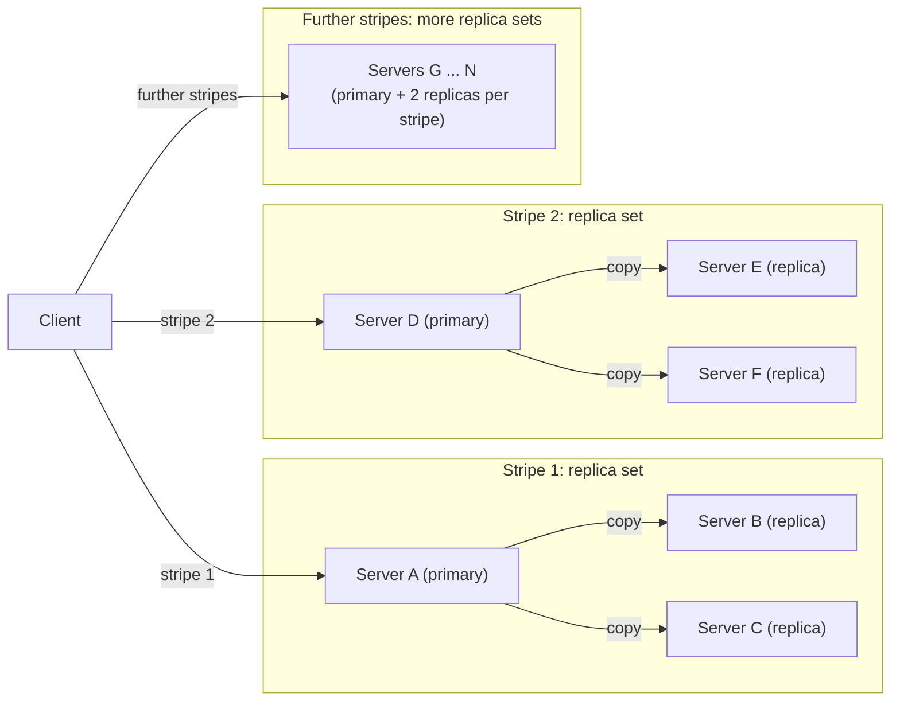
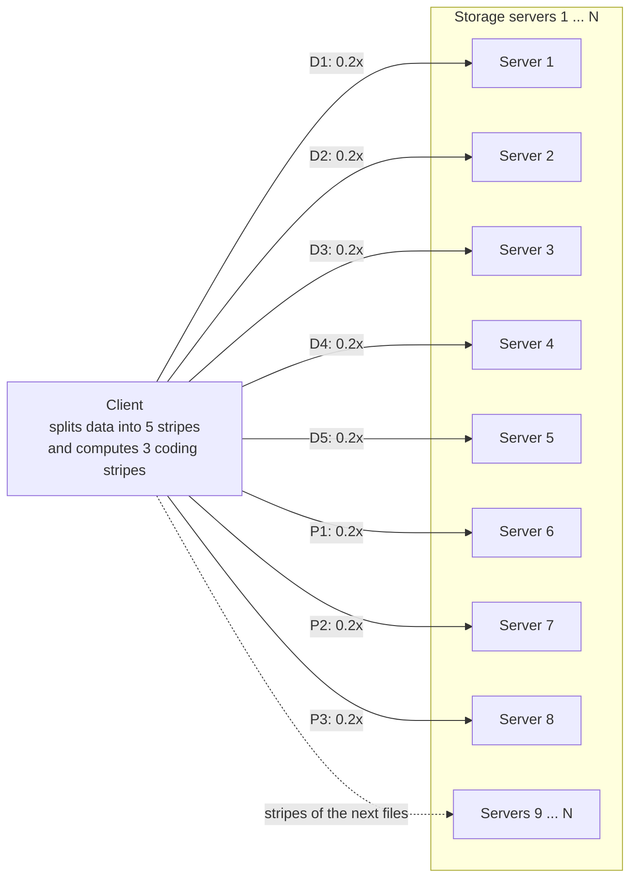
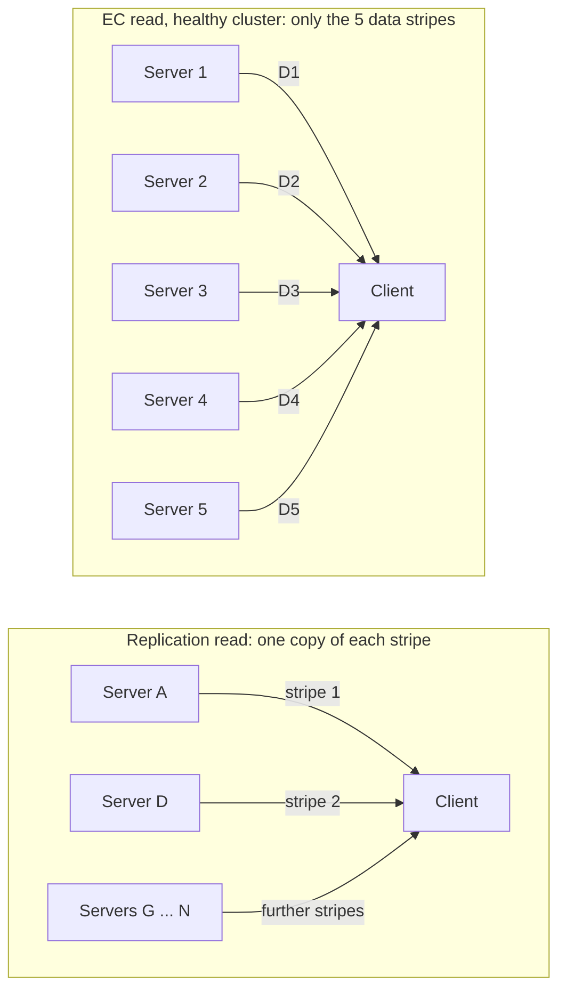

# Network traffic: replication vs. erasure coding

How redundancy traffic flows through the network in the model used by
`calc_ng.py`. All factors are per byte of user data. Examples use
3x replication and EC 5+3 (5 data stripes, 3 coding stripes).

- **Replication is done by the storage system.** The client sends each part of
  the data once to one server (the primary of that part). The primary forwards
  it to the other two servers of its replica set.
- **Erasure coding is done by the client.** The client creates the coding
  stripes and sends data and coding stripes directly to the servers.
- **Files are distributed across all servers.** With replication a file is
  striped, and each stripe has its own replica set of three servers. With EC
  each stripe goes to a different server. Because the sets are spread over all
  N servers, every server is primary for some stripes and replica for others,
  so the load is even.

## Replication write (3 copies, striped)

The client sends each stripe once, so in total it sends the data once (1x). The
sets can overlap: with fewer servers than the sets need, a server appears in
several sets. With a stripe width of 1 (the default) there is a single stripe
and only one replica set per file, but different files still use different sets.

| Link | Traffic |
|---|---|
| Client network | 1x |
| Storage NICs inbound (all servers together) | 3x (1 from the client, 2 forwarded) |
| Storage NICs outbound (all primaries together) | 2x |
| Devices and controllers | 3x |

## EC 5+3 write

D1 to D5 are the data stripes and P1 to P3 the coding stripes; each is one fifth
of the user data (0.2x), so the client sends 8 x 0.2x = 1.6x. The servers that
hold the stripes change from file to file, so all N servers share the load. If
there are fewer servers than stripes (8 here), a server holds more than one
stripe of a set.

| Link | Traffic |
|---|---|
| Client network | 1.6x (5 data + 3 coding stripes per 5 stripes of user data) |
| Storage NICs inbound (all servers together) | 1.6x |
| Storage NICs outbound | none (the servers do not forward anything) |
| Devices and controllers | 1.6x |

## Reads

Both read paths move 1x on the client network and 1x outbound on the storage
NICs. EC reads fetch only the data stripes, so the coding stripes cause no read
traffic while the cluster is healthy.

## Side by side

Per byte of user data written:

| | Replication (3 copies) | EC 5+3 |
|---|---|---|
| Client network | 1x | 1.6x |
| Storage NICs inbound | 3x | 1.6x |
| Storage NICs outbound | 2x | none |
| Devices and controllers | 3x | 1.6x |
| Usable capacity | 1/3 of raw (33%) | 5/8 of raw (62.5%) |

Writing 100 GB of user data:

| | Replication (3 copies) | EC 5+3 |
|---|---|---|
| Client sends | 100 GB | 160 GB |
| Storage nodes receive (total) | 300 GB | 160 GB |
| Storage nodes send (total) | 200 GB | 0 GB |
| Written to devices | 300 GB | 160 GB |

EC loads the storage network and the devices less than replication, but it puts
more load on the client network, because the client sends the coding stripes
as well. Replication keeps the client network at 1x, but the storage network
and the devices carry three copies.

## Assumptions

- Data, and the primary role for replication, are spread evenly across all
  servers.
- Client traffic and replication traffic share the same storage NICs. NICs are
  full duplex, so inbound and outbound traffic are limited separately.
- Acknowledgement and metadata traffic are ignored, and the cluster is healthy
  (no degraded reads or rebuilds).

See `README.md` for the full model.
